# NucleoOS P4 · an operating system for the Guition ESP32-P4 7" touchscreen

**NucleoOS turns the Guition JC1060P470C (ESP32-P4, 7", 1024×600) into a small computer you can
actually use:** a touch launcher and a classic desktop, an app store with over 400 apps and games,
an ebook reader with a catalog of free books, a spreadsheet and a word processor, game engines and
emulators, an assistant that works offline, a second-screen mode for your PC, a Home Assistant
dashboard, a virtual-pinball DMD, and signed updates over Wi-Fi. Flash it from Chrome in a few
minutes; no toolchain needed.

[](https://indecenti.github.io/nucleoos-p4-store/flash/)
[](https://github.com/indecenti/NucleoOS-P4/releases/latest)
[](https://indecenti.github.io/nucleoos-p4-store/)
[](docs/USER_GUIDE.md)


[](https://github.com/indecenti/NucleoOS-P4/actions/workflows/ci.yml)


<p align="center">
  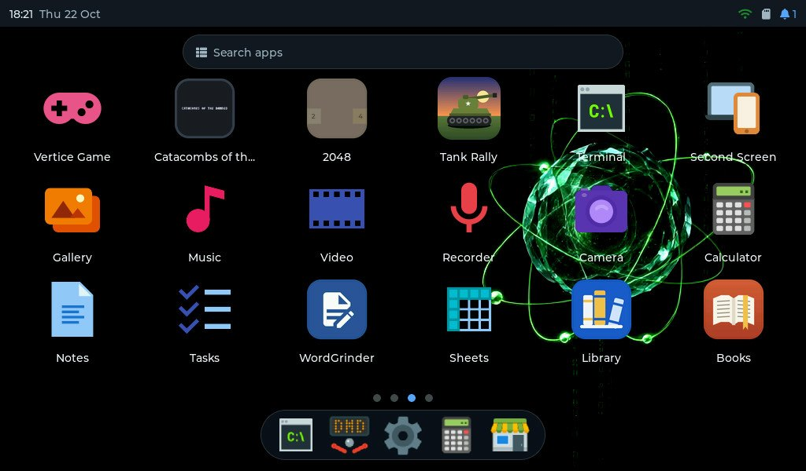
</p>

| Tablet launcher | Classic desktop | App Store |
|---|---|---|
|  | 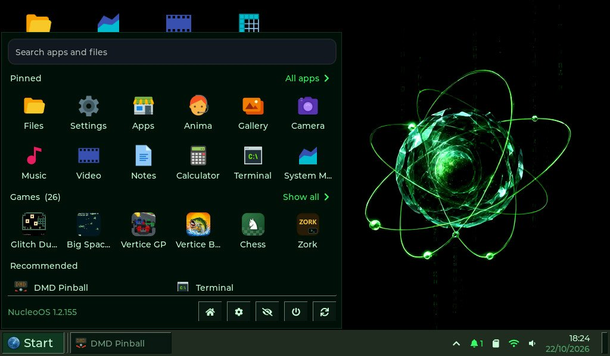 | 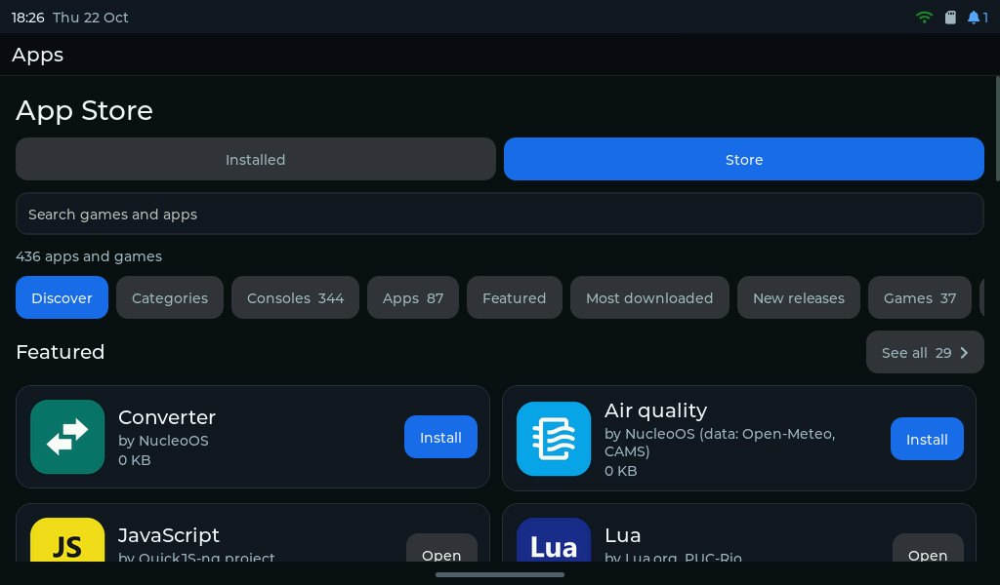 |
| **Books**: catalog and reader, upright | **Sheets**: xlsx spreadsheets | **ANIMA**: the assistant |
| 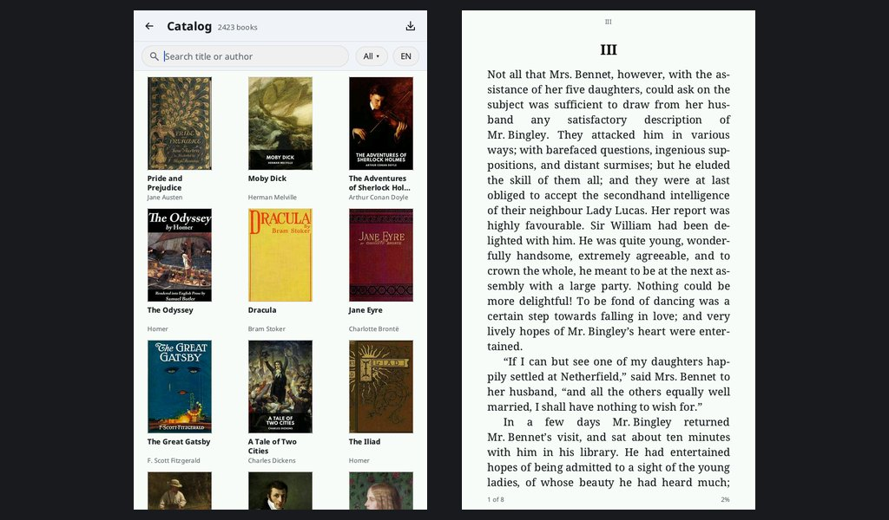 | 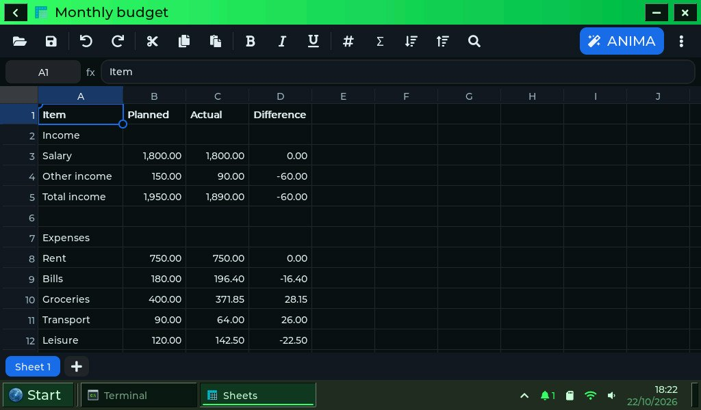 | 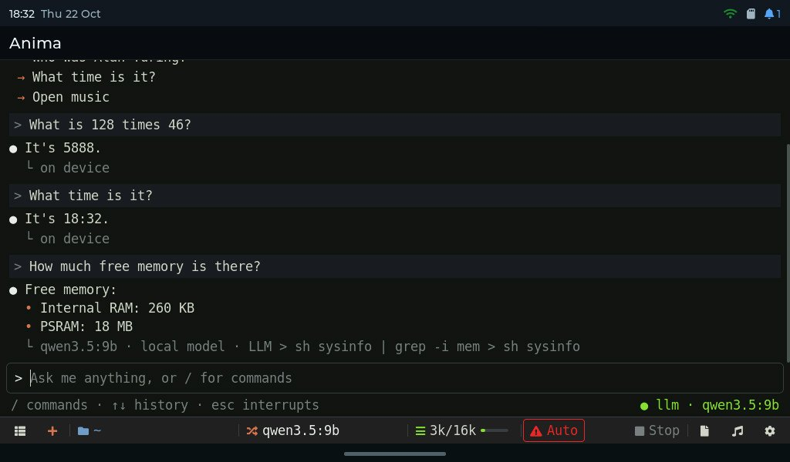 |
| **Doom engine** (Freedoom) | **Vertice GP**, a 3D game on our engine | **Game Boy** emulator |
| 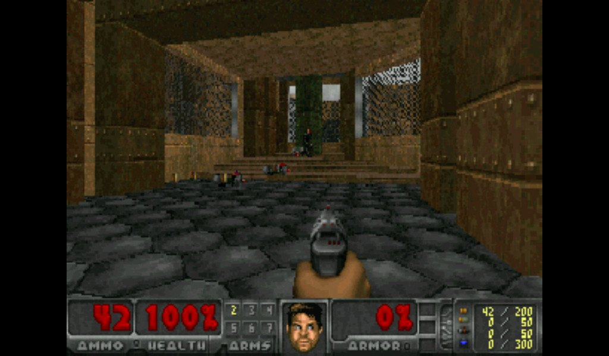 |  | 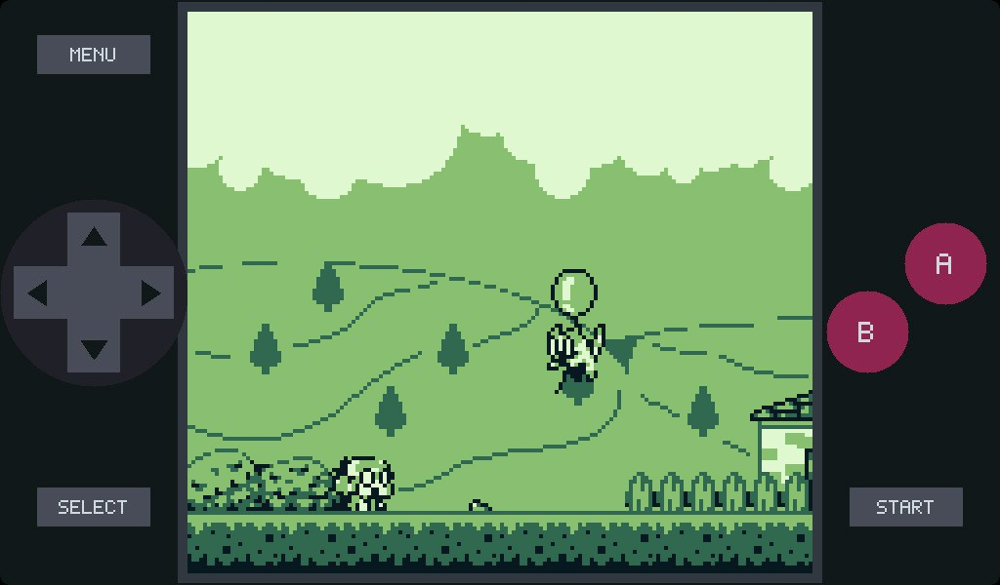 |
| **Terminal**: shell, Python, Lua | **Second Screen** for your PC | **System Monitor** |
| 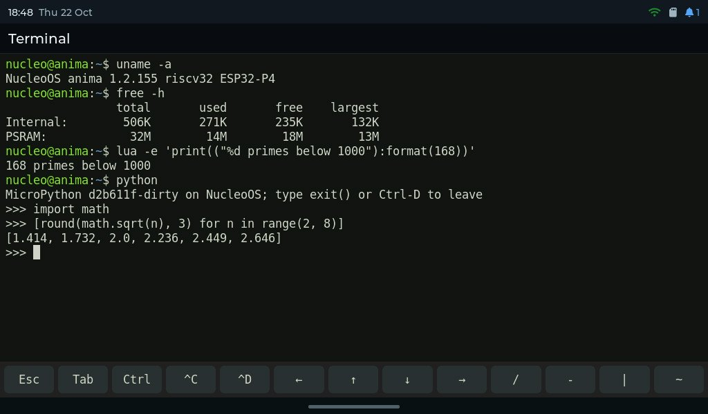 | 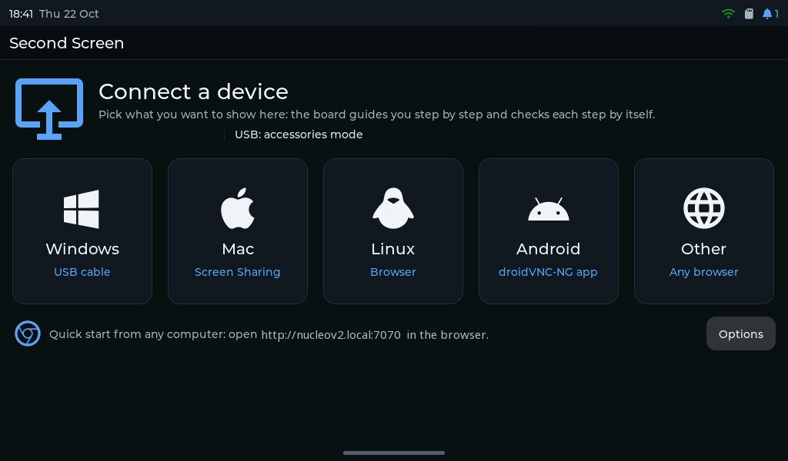 | 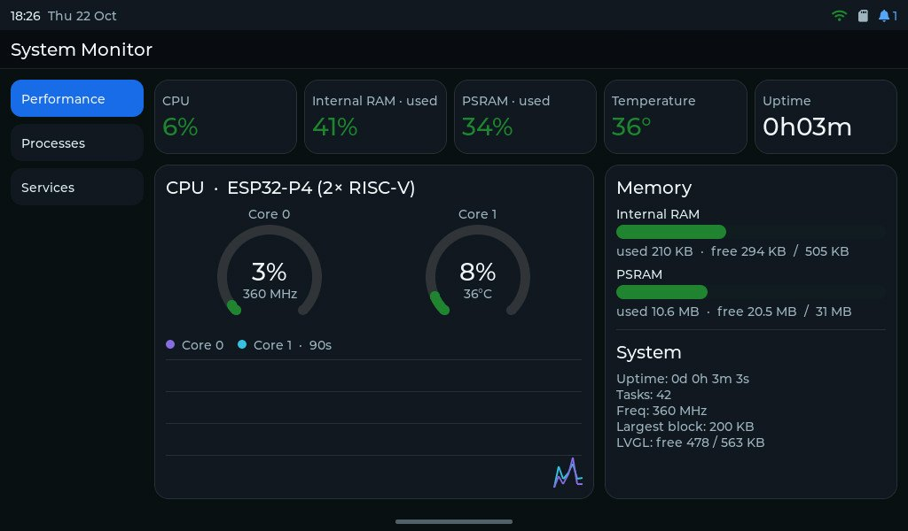 |

*Live captures from the device, 1024×600. What is verified on the board and what is still
experimental is listed feature by feature in [`docs/STATUS.md`](docs/STATUS.md).*

## Install in 3 steps

1. **Open the [web flasher](https://indecenti.github.io/nucleoos-p4-store/flash/)** in Chrome or
   Edge, plug the board in with a USB-C data cable, press *Connect & install*.
2. **Insert a FAT32 microSD.** Apps, books, media, offline content and updates live there.
3. **Follow the setup wizard**: language, Wi-Fi, then one tap downloads the offline content
   (ANIMA's data, dictionaries, the web companion, about 140 MB) in the background. Skipped it? Find
   it later in **Settings > System content**. From then on the board updates itself and installs
   apps from the Store.

Prefer the command line? Each [release](https://github.com/indecenti/NucleoOS-P4/releases/latest)
has a single factory image:
`esptool.py --chip esp32p4 write_flash 0x0 nucleoos-p4-<version>-jc1060p470c-factory.bin`

> Needs an ESP32-P4 chip revision v0.x/v1.x, which covers every board sold so far. On a v3 chip
> the bootloader won't start, and the stock firmware can be flashed back.

**New here? Read the [user guide](docs/USER_GUIDE.md)**: every feature, step by step.

## What you get

### Two desktops: tablet and classic
- **Tablet launcher**: adaptive grid with pages, folders, a dock, search and wallpapers;
  landscape and portrait; multitouch (5 points); system gestures only on the screen edges.
- **Classic desktop**: desktop icons, a taskbar, a Start menu with search, pinned apps and games,
  a system tray, windows with title bars, and right-click menus. Turn it on in **Settings >
  Display**, or let it switch on by itself when a mouse and a keyboard are plugged in. It changes
  only the shell; the apps look the same.
- **Keyboard and mouse everywhere**: USB or Bluetooth (BLE). Focus moves with Tab, Esc goes back,
  F1 shows the shortcuts, Alt+Tab and Alt+F4 work. There's a desktop-style selection
  (Ctrl/Shift/rubber band), **Open with** and default apps, a system clipboard for text, images and
  files, and a screen-region capture.

### App Store: over 400 apps and games, installed over Wi-Fi
| Platform | What's in it |
|---|---|
| WASM-4 | 149 fantasy-console games by the WASM-4 community |
| Arduboy | 83 games |
| Game Boy | a Peanut-GB emulator and 39 free homebrew ROMs |
| Doom engine | Chocolate Doom with OPL music; 32 packages, including Freedoom 1 and 2 |
| ScummVM | ScummVM 2.9.1 with 8 freeware adventures (Beneath a Steel Sky, Flight of the Amazon Queen…) |
| CHIP-8 | one app with 83 CHIP-8 / SUPER-CHIP / XO-CHIP games |
| Interactive fiction | 33 titles on Frotz and Glulxe, Zork included |
| Lua and LÖVE | 16 LÖVE games and more on the Lua App engine |
| Terminal | Lua 5.4, JavaScript (QuickJS-ng), MicroPython, BASIC, Berry, Wren, Tcl, Scheme, pForth, SQLite, jq, bc, GNU units, Eigenmath, pdfio, zstd, FIGlet… |
| Apps | Weather, Air quality, Home, Devices, Synth, Pianino, Timer, Pomodoro Desk Hub, Puzzles (40 games by Simon Tatham), Chess, Library, WordGrinder… |

Every package is **signed**: the device refuses unsigned or altered ones, and shows an app's
permissions (network, LAN, files) before you install it. The Store has categories, platforms,
search, featured lists and 5 languages; its catalog is static on GitHub Pages:
[browse it](https://indecenti.github.io/nucleoos-p4-store/). System tools (Lua, JavaScript,
Python, SQLite, the office programs) are installed and kept up to date automatically.

### Reading: Books and Library
- **Books** is a full ebook reader: EPUB 2/3 (fixed layout too), FB2, CBZ comics, TXT, HTML,
  Markdown. Justified pages with hyphenation in 11 languages, widows and orphans kept away, real
  chapters and a table of contents, bookmarks, notes, full-text search, one or two pages, and a
  picture viewer with zoom.
- **Six themes**: white, sepia, dark, black, an **e-ink simulation** with its refresh flash, and
  **1-bit** monochrome with dithered pictures.
- **Upright reading**: hold the board in portrait and the reader turns with it.
- **A catalog of free books inside the app**: thousands of rights-checked public-domain and
  freely licensed books (Project Gutenberg, Standard Ebooks, Wikisource, Wikibooks) in English,
  Italian, German, Spanish, French and more, with covers. Pick a language, search, download in one
  tap (checked with SHA-256), read.
- **Library** reads offline Wikipedia and any Kiwix ZIM file, pictures and formulas included, and
  downloads ZIM files from the Kiwix catalog.

### Office: Sheets and WordGrinder
- **Sheets** is a native spreadsheet. It opens and saves **xlsx**, opens xls, ods, csv and tsv,
  has function names in your language, templates (monthly budget, shopping list, timesheet) and a
  recovery copy. ANIMA can propose edits that you apply with one tap.
- **WordGrinder** is a word processor for the terminal: odt, Markdown and HTML.
- With the classic desktop and a keyboard, the board works as a small writing and accounting
  machine.

### Games, engines and emulators
- **Vertice**, a 3D engine in the firmware: it renders on both cores in tiles, with lights, fog,
  particles, models, a Mode-7 floor, 360° panoramas and picking. Games on it: Vertice GP (karts),
  Vertice Bass (fishing), Tank Rally.
- **Doom engine** (doomgeneric / Chocolate Doom) with OPL music, keyboard, mouse and gamepads.
- **ScummVM**, **Game Boy**, **Arduboy**, **CHIP-8**, **WASM-4** with its upstream rasterizer
  and sound, **interactive fiction**, and **LÖVE** games on Lua.
- An on-screen gamepad for touch, plus USB and Bluetooth gamepads (experimental).

### ANIMA, the assistant that works offline first
ANIMA answers on the device whenever it can and says "I don't know" instead of guessing:
- **On the device, with no network**: arithmetic, time and date, unit conversions, timers and
  alarms, opening apps, volume and brightness, system status, and knowledge cards from offline
  Wikipedia and Wikidata packs in five languages.
- **Four modes**: *offline*; *local*, with a model on your LAN (Ollama, LM Studio, llama.cpp),
  so nothing leaves your home; *hybrid*, the default, which adds the web; and *agent*, where a
  model leads the turn but everything the device can do exactly stays on the device.
- **Agent tools**: the shell, files, apps, timers, memory (up to 48 facts it learns about you),
  image input, skills, a permissions file that says what it may do, and periodic checks.
- **Bring your own model**: Groq/OpenAI-style APIs, Anthropic, Gemini, or a server on your
  network found automatically. **API keys never leave the device**: they are sealed to the chip.
- **Also from your phone and PC**: a Telegram bot, an MCP server for desktop AI clients, and the
  web chat. Optional offline **wake word** (ESP-SR WakeNet, off by default in the build).

### Second Screen: the board as a display for your computer
Pick your computer and the board guides you step by step:
- **Windows** over USB (an indirect-display driver);
- **Mac** with Screen Sharing (VNC, with Apple Remote Desktop authentication);
- **Linux**, **Android** (droidVNC-NG) or **any device with a browser** (NucleoCast).

Full details in [`docs/SECOND_SCREEN.md`](docs/SECOND_SCREEN.md). USB mode is experimental.

### Smart home: Home and Home Assistant
- **Home** (store app) is a touch dashboard for **Home Assistant**: tiles by room for lights with
  brightness, thermostats, covers, sensors, energy, locks and scenes. Set it up in **Settings >
  Home** with your Home Assistant URL and a long-lived access token, or paste them from a PC.
- The board announces its own sensors and controls to Home Assistant over **MQTT discovery**.
- Related store apps: Devices, Zigbee, openHASP, MQTT Explorer. Guide:
  [`docs/HOME_ASSISTANT.md`](docs/HOME_ASSISTANT.md).

### DMD Pinball: the display of a virtual pinball cabinet
The board becomes the cabinet's dot-matrix display for dmdext: over Wi-Fi (`networkstream`) or
USB, where it emulates a ZeDMD 128×32. Both links can be live at once. It offers nine layouts
(backglass + DMD among them), a clock when the PC is silent, dot colour, shape and glow, a test
screen, and a PinUP Popper touch menu to pick tables through a small PC bridge. Verified on a real
cabinet. Guide: [`docs/DMD.md`](docs/DMD.md).

<p align="center">
  
</p>

### Media
- **Camera** (OV02C10 module): auto exposure and white balance, photos, MJPEG video.
- **Music**: MP3, WAV, AAC, FLAC, M4A, with background playback and USB-audio output.
- **Video**: MJPEG `.avi` and MPEG-1 `.mpg`, tear-free. **Gallery** has hardware-JPEG thumbnails.
  **Recorder** records WAV (experimental).

### A desktop in your browser
Open the board's address in any browser, pair it with the 6-digit code shown on the screen, and
you get a windowed web OS with 40 apps: files, spreadsheet, SSH, mail, a DJ mixer, a media player,
a terminal, AI chat and agents, a system monitor and more. Everything runs against the device's
REST API.

<p align="center">
  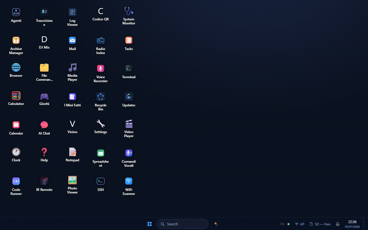
</p>

### The system underneath
- **Wi-Fi 6 through the ESP32-C6**, Bluetooth LE for keyboards, mice and gamepads; USB host for
  keyboards, mice, audio, gamepads and drives (drives and pads experimental).
- **Signed OTA updates** from GitHub with a primary and an offline backup key, a beta channel, a
  recovery app, a safe mode and a last-known-good copy in flash. Updates are staged on the SD card.
- **5 languages** (English, Italian, Spanish, French, German) and **offline text-to-speech** in
  Italian and English.
- **Hardware acceleration**: the JPEG codec, the PPA for scaling and rotation, and a
  double-buffered display with vsync. Apps get them too: hardware JPEG decoding and a canvas turned
  by the PPA (ABI 19).
- **RAM discipline**: one app runs at a time, and a PSRAM broker reclaims caches before heavy work.
- **A system downloader** with resume, SHA-256 checks and progress, shared by every app.

### For developers
- **Write apps in C, compiled to WebAssembly**, with the SDK in [`sdk/`](sdk/): graphics with
  dirty rectangles, sprites and panels, multitouch, keyboard and mouse, gamepads, audio and a mixer,
  voice, UDP, async HTTP, WebSocket, MQTT, mDNS, files (WASI), file associations, full-screen
  terminal programs, the downloader, canvas rotation and hardware JPEG. Host ABI **19**: see the
  table in [`docs/WASM_APPS.md`](docs/WASM_APPS.md).
- Or write **Lua apps** with `gfx`/`ui`/`nv` modules and a LÖVE layer
  ([`docs/LUA_APPS.md`](docs/LUA_APPS.md)), or **native C++** apps.
- **AOT compilation** (WAMR `wamrc`) for native speed on the P4's RISC-V cores, with an
  interpreter fallback.
- **Hot reload over Wi-Fi**, remote UI automation and screenshots over HTTP (`/api/ui/*`,
  `/api/screen`), and a remote shell. The API is paired: a 6-digit code on the device, then a
  session token (`python tools/pair.py`).
- **Start here:** [`docs/APP_SDK.md`](docs/APP_SDK.md) helps you choose a runtime (native C++,
  WASM, Lua, web). Then: architecture [`ARCHITECTURE.md`](ARCHITECTURE.md) · app guide
  [`docs/WASM_APPS.md`](docs/WASM_APPS.md) · game guide [`docs/GAME_DEV.md`](docs/GAME_DEV.md) ·
  3D engine [`docs/VERTICE.md`](docs/VERTICE.md) · shell [`docs/SHELL.md`](docs/SHELL.md).

## Documentation
| For | Read |
|---|---|
| Using the board | [User guide](docs/USER_GUIDE.md) · [Shell reference](docs/SHELL.md) · [Books](apps/libri/GUIDE.en.md) |
| ANIMA | [Modes](docs/ANIMA_MODES.md) · [Knowledge packs](docs/ANIMA_KB.md) · [Workspace, tools and Telegram](docs/ANIMA_WORKSPACE.md) · [Hands-free](docs/HANDSFREE.md) |
| Connections | [Second Screen](docs/SECOND_SCREEN.md) · [Home Assistant](docs/HOME_ASSISTANT.md) · [DMD Pinball](docs/DMD.md) · [Open with](docs/FILE_ASSOCIATIONS.md) |
| Updates and safety | [OTA](docs/OTA.md) · [Security](SECURITY.md) · [Feature status](docs/STATUS.md) |
| Building apps | [App SDK](docs/APP_SDK.md) · [WASM apps](docs/WASM_APPS.md) · [Lua apps](docs/LUA_APPS.md) · [Games](docs/GAME_DEV.md) · [Vertice 3D](docs/VERTICE.md) |
| Working on the OS | [Architecture](ARCHITECTURE.md) · [Engineering rules](docs/ENGINEERING_RULES.md) · [Contributing](CONTRIBUTING.md) |

## Engineering and testing
- **CI on every commit** ([`ci.yml`](.github/workflows/ci.yml)): a clean ESP-IDF build from pinned
  dependencies, a check that the lock file did not drift, **memory budgets** (internal static RAM
  and IRAM) that fail the build when exceeded, manifest checks, and a privacy check that keeps
  personal data and secrets out of the public repo.
- **Host tests and fuzzers** ([`tests/host`](tests/host)): 35 unit-test files and 16 libFuzzer
  targets for every parser that reads untrusted input (AVI, MP4, MPEG-1, JPEG headers, web paths and
  queries, OTA manifests, store packages, pairing, app network policy, Home Assistant replies…),
  under AddressSanitizer and UBSan, as 64-bit and 32-bit builds since the P4 is 32-bit. A weekly job
  fuzzes longer. The fuzzers have found real bugs (path-guard bypasses, decoder hangs and
  out-of-bounds reads), each fixed with a regression test.
- **Hardware in the loop** ([`tools/hil`](tools/hil)): opens and closes every app watching for
  reboots, freezes and leaks; checks the OTA safety net, downloads with resume, canvas rotation and
  hardware JPEG on the real board.
- **Crash forensics**: coredumps and an interrupt-storm watchdog are kept across reboots and served
  at `/api/crash`.
- **Engineering rules** ([`docs/ENGINEERING_RULES.md`](docs/ENGINEERING_RULES.md)): each rule comes
  from a real crash or freeze on this board, with the reason.
- **Security** ([`SECURITY.md`](SECURITY.md)): signed firmware and apps, a paired web API with
  Host/Origin checks, a lock-screen PIN, a security event log; what is protected and what is not.

## Known limitations
- **H.264 / MP4 video is not supported.** Use MJPEG `.avi` or MPEG-1 `.mpg`.
- **No Classic Bluetooth**: the ESP32-C6 co-processor runs BLE only.
- **One app runs at a time**, by design: the RAM goes to the app in front.
- **No Secure Boot or flash encryption** by default; settings encryption is implemented but off in
  shared builds.
- The **web companion is plain HTTP** on your LAN, protected by pairing.
- The CPU runs at 360 MHz: this board does not boot reliably at 400 MHz.
- Experimental features are marked in [`docs/STATUS.md`](docs/STATUS.md).

## Supported hardware
| Board | Status |
|---|---|
| **Guition JC1060P470C_I_W**: 7" ESP32-P4, 1024×600, JD9165 panel | ✅ primary target, used daily |
| Guition JC1060P470 with the newer panel revision (non-JD9165) | ❓ untested, reports welcome |
| Guition JC8012P4A1 (10.1" ESP32-P4) | ❌ not supported yet |

Also sold as "Guition ESP32-P4 7 inch display", "JC1060P470C", "JC1060P470C-I-W" (AliExpress /
Guition store): the same board with the JC-ESP32P4-M3 module.

- SoC: **ESP32-P4** (+ ESP32-C6 co-processor for Wi-Fi 6 / BLE via `esp_hosted`), 32 MB PSRAM, 16 MB flash
- Display: JD9165 7" **1024×600** MIPI-DSI, GT911 capacitive touch
- Audio: ES8311 codec (I²S) + on-board mic; hot-plug USB-audio (UAC) output
- Camera: MIPI-CSI connector (tested with an OV02C10 module); storage: microSD (FATFS)

## Build from source
Requires **ESP-IDF v5.5.2** (Linux, macOS or Windows).

```sh
. $IDF_PATH/export.sh              # Windows: run export.ps1 from your ESP-IDF folder
sh tools/ci/fetch_wamr.sh          # WebAssembly runtime at the pinned commit, plus the project patch
idf.py set-target esp32p4
idf.py build
idf.py -p <port> flash monitor     # e.g. /dev/ttyUSB0 or COM5
```

The same steps run in CI on a clean container, so a fresh checkout builds.

`sdkconfig` is generated from `sdkconfig.defaults*` (kept in-tree); component-manager
dependencies are pinned by `dependencies.lock`.

## Layout
| Path | What |
|------|------|
| `main/` | boot entry (`app_main.cpp`) |
| `components/nv_*` | OS subsystems: hal, ui, kernel, apps, wasm, media, tts, anima, web, dmd, … |
| `components/vertice` | the Vertice 3D engine |
| `apps/` | app packages: sources, manifests, store screenshots |
| `ports/` | third-party ports (Doom, ScummVM, Lua, the Books reader, the ZIM reader, CLI tools…) |
| `sdk/` | WASM app C SDK (`nucleo_sdk.h`) |
| `sd/web` | web OS companion (PWA served over Wi-Fi) |
| `server/appstore` | the store's catalog sources |
| `tools/` | builds, store and OTA publishing, HIL tests, asset generators |
| `tests/host` | host unit tests and fuzzers |

> `system/icons/mdi` and `system/icons/flat-color` are third-party icon repos (own git history),
> not tracked here; re-clone them only if you need to regenerate `nv_icons.c`.

## Contributing
PRs welcome, see [`CONTRIBUTING.md`](CONTRIBUTING.md) (it includes a short contributor agreement
so the project can stay dual-licensed). Third-party components and their licenses are listed in
[`THIRD_PARTY.md`](THIRD_PARTY.md).

## License
**[PolyForm Noncommercial License 1.0.0](LICENSE.md)**: free for any **noncommercial** use
(personal, study, research, hobby, non-profit, education, government).

**Commercial or production use requires a paid commercial license**, see
[`COMMERCIAL.md`](COMMERCIAL.md). Want to ship NucleoOS P4 in a product? Get in touch:
**niki070585@gmail.com**.

© 2026 indecenti. All rights reserved.
