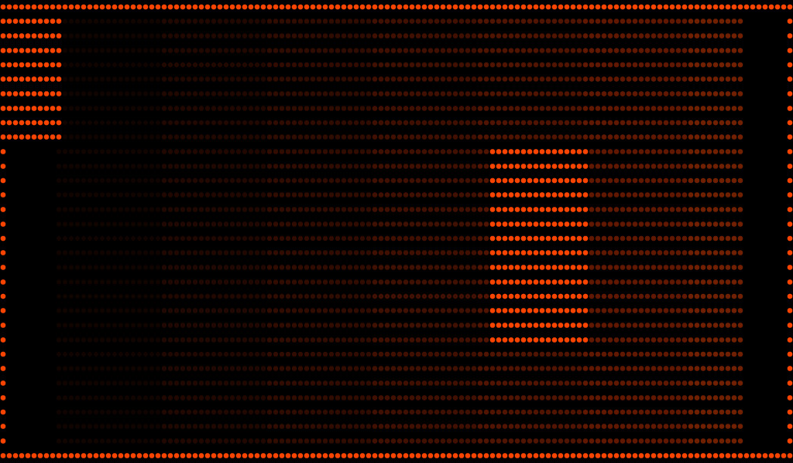
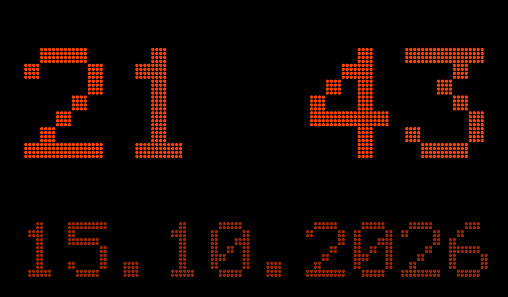

# DMD Flipper: the board as a pinball cabinet's DMD

The **DMD Flipper** app (`components/nv_apps/dmd_app.cpp`, id `dmd`) turns the board into the external
dot-matrix display of a virtual pinball cabinet. The PC (VPX + VPinMAME + dmdext 2.x) streams the DMD over
Wi-Fi or USB, both live at once; the board draws every frame as LED/plasma dots, over the whole panel by
default.



## On the PC

Nothing to install: dmdext already has both outputs. In `DmdDevice.ini`, one of the two:

```ini
; Wi-Fi
[networkstream]
enabled = true
url = ws://<board IP>:9090/dmd
retry = true
```

```ini
; USB: the board's programming port (USB-Serial-JTAG, 303A:1001), found by itself
[zedmd]
enabled = true
```

- **Wi-Fi**: the app's waiting page shows the exact URL. Port 9090 is the default (changeable in the panel).
  Give the board a fixed IP (DHCP reservation in the router) so the URL never changes.
- **USB**: the board answers as a ZeDMD 128x32 (ZeDMD firmware 5.1.8's protocol, as libzedmd 0.11.0 in
  dmdext 2.5 drives it). dmdext scans the serial ports and finds it; `port = COMx` under `[zedmd]` pins it.
  The app must be open when the game starts (dmdext looks for the device then): turn on "Start at
  power-on". While a PC streams over USB the serial log is muted (a log line would land inside the
  protocol); the log ring (`/api/logs`) keeps recording.

## On the board

| Moment | What the screen shows |
|---|---|
| Frames from the PC | only the dots; touch does nothing (no shade, no Home / Recents gesture) |
| PC silent for 5 s, a PC has shown something since the app opened, "Clock" on | the clock in dots: HH:MM, colon blinking, the date below, over the whole panel, always with round dots |
| No PC yet (or clock off) | the waiting page: the Wi-Fi URL, both `DmdDevice.ini` setups, Wi-Fi / port problems, a DMD size that does not fit |
| Hold the screen 2 s, or Enter / Esc | the panel (below) |



**The panel** (`dmd_panel.cpp`, drawn with the app's own widgets `dmd_ui.h`, the same look as the
composition screen; the simulator shows it: `python tests/host/sim_dmd/run.py panel`): the link in one line
(USB / Wi-Fi, format, size, frames per second, game) and the buttons *Back to the DMD*, *Test screen*,
*Close the DMD*; then four sections:

| Section | Setting | Values | Key (`nv_config`) |
|---|---|---|---|
| Screen | Layout for every table: its name, what it does, *Choose with previews* | Automatic + the nine fits below | `dmd_fit` |
| | Rotation | 0 / 90 / 180 / 270 | `dmd_rot` |
| Dots | Colour (gray frames), each with its swatch | from the PC / orange / red / yellow / green / cyan / white | `dmd_color` |
| | Brightness | 10-100 % | `dmd_bright` |
| | Dot shape, Glow | round / square; on / off | `dmd_shape`, `dmd_glow` |
| Table menu | Menu style | Cabinet / DMD | `dmd_theme` |
| System | Clock when the PC is silent, Start at power-on | on / off | `dmd_clock`, `boot_app` = `dmd` |
| | Network port (and the address a PC on Wi-Fi uses) | 9090 | `dmd_port` |

**One place to choose the layout: the composition screen**, with previews. From the panel it sets the layout
for every table (Automatic and the nine fits in a grid, all in view); in a game, from the quick actions, it sets the running
table's own (with "as every table", the second screen, the dots and the margin). Both show the chosen fit's
name and a line on what it does, and a **1:1 lens**: the middle of the DMD drawn by the real renderer at the
panel's real size, so the dot size and the gaps between rows can be judged before leaving (a thumbnail cannot
show them). When the panel has a table of its own, the layout card says so.

The dot (`dmd_mask_build`, the same for the game's DMD and the menu's dot text): a round dot 90% of its cell
wide (a square one 84%), anti-aliased, with a hot core — out to 3/4 of the radius the colour steps towards
white, up to 40% at the centre, in proportion to how lit the dot is (an unlit dot, a ninth of the colour, stays
dark). Glow adds a halo of up to 32% in the gaps. Before, the dot was 84% wide and flat: about half the cell
lit, and even at full brightness it never went past its flat colour, which looked dull.

**Test screen** (10 s): "TEST", the monochrome colour in 16 steps (as gray4 frames have), colour bars (R G
B Y C M W grey), a border and a solid block in the top-left corner. It checks the cabinet's orientation,
colours and brightness without a PC.

**Start at power-on** sets the system key `boot_app` (any app id works): the shell opens that app a second
after boot, unless the lock screen is up.

## Fit

**Automatic** (per table, the best fit for the pictures it has — art with window when it has
FullDMD art, backglass with housing when it has the grill, else Classic DMD) and nine fits, with the same names in the panel and in the composition screen (most useful first, as the
cards show them); the dots stay true circles (or squares) in all of them.

- **Full-screen DMD** (the rebuilt DMD, fit 6): the whole panel with no gaps. A 4:1 picture on a 1.7:1 panel
  must grow ~2.3x in height: the rows are rebuilt with Scale2x (32 -> 64, a 128x16 DMD 16 -> 64), the rest
  only spaces the dot rows out: round 8 px dots, rows 9-10 px apart, 128x64 dots over all 1024x600.
- **Classic DMD** (default): square cells, the largest integer size that fits, centred: 128x32 and 128x16 →
  8 px (1024x256), 192x64 → 5 px, 256x64 → 4 px; ambient bands above and below.
- **Tall DMD**: the whole width and 320 px tall (a little more than the 4:1 picture), bands above and below.
- **Stretched DMD** (fit 0): every panel pixel, the original dots. Cells are rectangles (128x32 on 1024x600:
  8 x 18.75 px) and the dot is sized on the shorter side, so a 4:1 DMD gets a lot of dark between its rows.
  Kept for whoever wants no rebuilt rows; seen on the cabinet as "small dots, too black".
- **Backglass + DMD** (backbox): square dots along the bottom of the panel, the running table's backglass
  above them, like a real backbox (art on top, DMD in the speaker panel). The bridge sends the backglass
  at 512x300 just before it hands the port to dmdext (converted once on the PC, cached); the board
  enlarges it, fills the sides of a 4:3 backglass with an ambient glow of its own colours (16x6 averages,
  darkened) and fades its last rows into the DMD. Without the art (a table with no backglass image) the
  DMD is centred as in "DMD only".
- **Backglass only**: the board is the backglass screen: the art over the whole panel, no DMD.
- **Table art** (FullDMD): the table's FullDMD art on top, the DMD in a wide band below.
- **Art with window**: the FullDMD art over the whole panel, the DMD inside its window.
- **Backglass with housing**: the backglass of a 2-screen .directb2s with its grill, the DMD in its housing.
- The clock is always drawn as 128x75 dots of 8 px (1024x600 exactly), square cells, whatever the fit.

## Drawing (measured on the board, `GET /api/display`: `layer_draw_us_avg`)

The picture is an `nv_disp` layer: drawn into the back buffer during a present, shown at vsync, only when
it changed. How a frame is drawn:

1. **A cache of finished dots**, one per colour and cell shape (`dmd_sprites_t`): a dot row costs a few
   32-bit copies instead of a table look-up per pixel.
2. **Strips in internal SRAM** (~32-38 KB, two of them, only while the DMD is on screen), copied into the
   frame by the AXI-GDMA while the next strip is drawn: the CPU writing PSRAM itself reads every cache line
   first, and the DMA's cost is mostly per transfer.
3. **Cell positions computed once** per geometry (a 64-bit division per dot per panel row cost 30 ms a
   frame on the RV32 core).
4. The receivers never wait on the display: the renderer copies the newest frame (16 KB for 128x32) and
   draws from its copy, so the USB link always acks within libzedmd's 16 ms.

| 128x32 | Panel area | Draw | First version |
|---|---|---|---|
| Original proportions | 1024x256 (512 KB) | **4.5-5 ms** | 17.6 ms |
| Whole screen | 1024x600 (1.2 MB) | **13.7 ms** | 40 ms |

Over USB the link carries 60 fps with every chunk acked (960 of 960 in a 16 s run). The whole-screen
picture is shown at ~30 fps today (13.7 ms of drawing, then the vsync wait of the double buffer); square
dots reach ~52-60. A known next step to speed up the whole screen: redraw only the dot rows that changed.

## Protocols

**Wi-Fi** (verified on freezy/dmd-extensions e54b239): WebSocket, binary messages `<name>\0<payload>`,
little-endian int32, colours `0x00RRGGBB`. Messages: `gameName` (ASCII, no terminator), `dimensions`
(w, h), `color`, `palette` (n, n colours), `clearColor`, `clearPalette`, `gray2Planes` / `gray4Planes`
(uint32 timestamp, planes), `coloredGray2` / `coloredGray4` (timestamp, n, n colours, planes), `rgb24`
(timestamp, w*h*3 bytes R,G,B). Bit-planes: plane k = bit k of the level, `w*h/8` bytes each, bit 0 of a
byte = leftmost pixel. websocket-sharp splits every message over 1016 bytes into continuation frames: the
server reassembles them. One client at a time: a new connection replaces the old one.

**USB** (verified on PPUC/libzedmd v0.11.0 and PPUC/ZeDMD v5.1.8): handshake `FRAME` `ZeDMD` 0x0C → a
64-byte answer (`ZeDM`, width, height, version, package size, …, byte 57 = `R`, then `ZeDMDA`). Then each
frame is `FRAME` + commands `ZeDMD` cmd size_hi size_lo compressed payload: 0x05 = the changed 8x4 zones,
RGB565 little-endian, zlib when flagged (`[idx][64 bytes]` or `[idx+128]` = black zone), 0x06 = render,
0x0A = clear, 0x0B = keep-alive. The PC cuts a transfer into chunks of the announced package size (1920
bytes), zero-padded, and waits up to 16 ms for `ZeDMDA` after each; a miss makes it resend a full frame
next time. 0x1F (reset) is what dmdext sends when it closes: the board only marks the USB PC as gone.

## Code and tests

| Part | File |
|---|---|
| WebSocket upgrade + frames, dmdext decoder, ZeDMD parser, geometry, masks, dot cache, renderer, 5x7 text (pure C) | `components/nv_dmd/dmd_core.c` |
| Wi-Fi server task, USB task (USB-Serial-JTAG driver), the newest frame, pictures made on the board | `components/nv_dmd/nv_dmd.c` |
| App: waiting page, nv_disp layer, strips + DMA, clock, test screen, panel, settings | `components/nv_apps/dmd_app.cpp` |
| Unit tests (395 checks) / fuzzer | `tests/host/unit/test_dmd.cpp`, `tests/host/fuzz/fuzz_dmd.cpp` (target `dmd`) |
| PC test sender (no pinball needed) | `tools/dmd_sender.py` |

```sh
python tools/dmd_sender.py <board IP>                       # Wi-Fi: every format in turn, 128x32, 60 fps
python tools/dmd_sender.py <board IP> --fmt rgb24 --size 256x64 --fps 30
python tools/dmd_sender.py --usb COM6 --seconds 20          # USB, as dmdext's [zedmd] (needs pyserial)
python tools/dmd_sender.py --usb COM6 --text "CIAO|NICOLA"  # USB: a text, '|' = new line
```

The test picture has a solid block in the top-left corner: with rotation 0 it must show top-left.

## Leaving the app

The app asks before the user leaves it ("Close the DMD?", *Stay* focused): the panel's *Close the DMD*, Back,
the bottom-edge Home / Recents gesture and the system keys (Alt+F4, Ctrl+W, Win, Ctrl+Esc, Win+D, Alt/Win+Tab)
all go through `nv_ui_set_leave_guard`. Automation is never asked: `GET /api/ui/home` (used before flashing)
closes it at once.

## Receiver API notes

- `nv_dmd_set_port(port)`: a new Wi-Fi port restarts only the WebSocket task; USB (dmdext, the bridge) and
  the newest frame stay.
- `nv_dmd_copy(dst, cap, &w, &h)`: a copy of the newest frame for previews; `nv_dmd_acquire` is the
  display's alone.
- The menu link resyncs after any loss (payload and trailer searched, a partial magic kept), resets a message
  cut off for over 1 s, and replays at most one level; a ZeDMD session ends after 10 s without a ZeDMD
  command (keep-alives count) or when the bridge talks again. `zedmd_resets` in the status counts the
  12 ms transfer resets.

## Known limits

- The host tests ran at 64 bit only on this PC (the 32-bit build needs `gcc-multilib` in WSL).
- **dmdext resets the board when it opens the port** (verified on the cabinet: reset reason `usb` at every
  table start, then "ZeDMD is not available"): Windows / libserialport toggle DTR/RTS like esptool. While
  the DMD app owns the port, `nv_dmd` sets `USB_SERIAL_JTAG_CHIP_RST_REG.USB_UART_CHIP_RST_DIS` (bit 2 at
  `DR_REG_USB_SERIAL_JTAG_BASE + 0x4c`), so nothing resets the chip from the USB serial channel; leaving
  the app clears it. Consequence for flashing: close the app first (`GET /api/ui/home`), then esptool.
- A USB hub without its own supply left the board without power (reset reason `poweron` whenever the
  menu decoded images): plug the board straight into the PC.
- Our sender opens the serial port with DTR and RTS low for the same reason.
- Over USB the board is a 128x32 ZeDMD: dmdext scales other sizes to it. Over Wi-Fi any size up to 512x256
  (32768 dots) is shown as sent.
- Settings live in NVS (`nv_config`, like every app's), not on the microSD.

## PinUP Popper menu

When no table runs, the touch screen is a menu of PinUP Popper's tables, served over the same USB port by
`tools/popper_bridge`; during a game a tap on the DMD opens quick actions (back, tables, quit the game,
settings). Details and status: [DMD_POPPER.md](DMD_POPPER.md).
